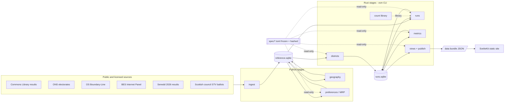

# Architecture

## System overview

Voting System Metrics (VSM) is a **batch pipeline** that ends in a **static website**. Nothing runs on a server at request time.

The pipeline has eight stages. Each one reads files and writes files, and each is a separate command:

1. **Ingest** (Python) downloads or reads source data and normalises it into a canonical reference store. Sources: Commons Library results, Office for National Statistics (ONS) electorates, Ordnance Survey (OS) Boundary-Line, the British Election Study (BES), Senedd 2026 results, and Scottish council Single Transferable Vote (STV) ballots.
2. **Geography** (Python) derives each constituency's area, its adjacency graph and its local-authority coterminosity.
3. **Preferences** (Python) turns BES like–dislike scores into sincere ranked-ballot profiles per constituency (scenario S1). It uses multilevel regression and post-stratification (MRP) and a declared tie rule, and it is calibrated against observed ranked ballots.
4. **Districts** (Rust) generates 20 seeded, valid multi-member district plans per configuration that needs them.
5. **Count** (Rust) implements the electoral rules: First Past the Post (FPTP), Alternative Vote (AV), Two-Round System (TRS), STV with Weighted Inclusive Gregory Method (WIGM) and Droop quota, List PR with D'Hondt and Sainte-Laguë, Additional Member System (AMS), AV+ and Parallel.
6. **Runs** (Rust) expands the run matrix (configuration × reference election × scenario × plan), counts every run and stores seat outcomes.
7. **Metrics** (Rust) computes the 26 sub-metrics per run, normalises them against the frozen anchors, aggregates them to median and p10–p90, and assigns evidence grades.
8. **Views and publish** (Rust) builds the Pareto set, Punter view (axis and cluster level, basic and confident floors), Fair Fight view, weight-profile ranks and weight-space sensitivity. It exports a versioned JSON data bundle that the **SvelteKit static site** renders.

The **frozen spec** is a set of TOML files: configurations, anchors, star bands, reference contest, criteria table, weight profiles and grade rules. Every stage reads it, and none may change it. Its SHA-256 hash is stamped on every output.

## Component diagram

## Data flow

### Flow 1: one S0 run of C09 (closed-list PR, Senedd model) on 2024

1. `ingest` loads 2024 candidate results from the Commons Library CSV into `reference.sqlite` (`election`, `contest`, `candidate_result`), with party codes normalised to the project's party registry.
2. `geography` has already stored each 2023 constituency's area, adjacency edges and local-authority overlap.
3. `districts` reads C09 from `spec/configurations.toml` (six-member districts, built by pairing whole constituencies within a nation) and generates plan 7 of 20 with seed `hash(spec_hash, "C09", 7)`. It writes the plan's district membership to `runs.sqlite`.
4. `runs` creates run record `(C09, GE2024, S0, plan 7)`. For each district it sums the constituency party votes (S0 means actual FPTP votes, unchanged). It calls `count::list::dhondt(district_votes, magnitude=6, threshold=None)` and writes seat allocations.
5. `metrics` reads the run's votes and seats. It computes the raw values (Gallagher index UK-wide and worst nation, effective ballots, contestability margin per district, malapportionment, partisan bias, safe-seat share under a 10-point swing, district electorate, area and coterminosity, and so on). It normalises each with the frozen anchors and writes `submetric_value` rows.
6. Once all runs for C09 finish, `metrics aggregate` computes the median and p10–p90 per sub-metric and axis across all its runs, then attaches grades. The grade is A for the devolved profile (Senedd 2026 is observed) and C for the Commons profile.
7. `views` places C09 in the Punter, Pareto, Fair Fight and profile tables. `publish` writes `bundle/v{spec_version}/commons.json`.
8. The site reads the bundle at build time and renders C09's star row, hemicycle and hex map.

### Flow 2: one S1 run of C04 (STV, 3–5 member districts) on 2024

1. `preferences` estimates, for each constituency, a weighted set of ranked party ballots (with truncation and exhaustion) from BES like–dislike scores through MRP. It stores them as `ballot_profile` rows tagged with the model version and the calibration fit.
2. `districts` builds a 3–5 member plan.
3. `runs` expands each party ballot into candidate ballots for the district. Parties field as many candidates as the configuration's nomination rule says; intra-party ordering follows the declared rule. It then calls `count::stv::wigm_droop`.
4. The stage-by-stage transfer log is kept per district, because sub-metrics E1 (effective ballots), E3 (contestability: last-elected against first-not-elected at the final stage) and C1 (safe seats, which need a re-count after a 10-point swing) all depend on it.

## Trust boundaries

| Boundary | What crosses it | Control |
|----------|-----------------|---------|
| Internet → `ingest` | Third-party files | Pinned URLs and SHA-256 checksums in `data/sources.toml`. A mismatch stops the pipeline |
| Licensed survey data → repository | BES respondent-level data | Never crosses. Kept in a git-ignored `data/private/`. Only derived aggregates reach `reference.sqlite` exports (see [06_SECURITY.md](06_SECURITY.md)) |
| Frozen spec → all stages | Anchors, configurations, weights | Read-only. Stages verify the hash recorded in `spec/FROZEN` before running |
| Python stages → Rust stages | SQLite tables | Schema version check on open. Rust refuses an unknown `schema_version` |
| Pipeline → published bundle | JSON | Bundle carries spec hash, data hashes, git commit and engine version. The site displays them |
| Published site → readers | HTML, JSON | Static, read-only. Integrity rests on the public repository and the reproducibility check |

## Deployment topology

| Component | Where it runs |
|-----------|---------------|
| Pipeline (all stages) | Maintainer's M1 MacBook Pro ("Kirk"). Optionally the lid-down 2015 MacBook Pro server ("SpocksPad") for long S1 batches |
| Reproducibility check | Local rebuild (`just verify`) by the maintainer before each tag; no hosted CI. It re-runs a reduced matrix and compares hashes ([09_TESTING.md](09_TESTING.md)) |
| Static site | <!-- TODO: static host not chosen. Candidates: Cloudflare Pages, GitHub Pages. See ADR-0010 (Proposed). --> |
| Data bundle archive | Attached to each tagged release on the repository host, plus <!-- TODO: long-term archive with a DOI, e.g. Zenodo — confirm --> |

## External dependencies

| Dependency | If unavailable |
|------------|----------------|
| Commons Library election results site | No new ingest. Cached, checksummed copies in the release archive still allow rebuilds |
| ONS / Boundary Commission electorate data | As above |
| OS Boundary-Line | As above |
| BES data portal | S1 cannot be rebuilt from scratch. Published aggregates still reproduce all downstream stages |
| Scottish council ballot collections (Mollison, Teale) | Calibration cannot be re-fitted. Stored calibration parameters still allow rebuilds |
| Rust and Python package registries | Builds fail. Mitigated by lockfiles (`Cargo.lock`, `uv.lock`, `package-lock.json`) and vendoring at release |
| Static host | Site down. The bundle and code remain on the repository host |

## Cross-cutting concerns

Brief pointers. Full detail lives in the dedicated files.

- **Determinism.** Every random choice (district plans, MRP draws, simulation noise) uses a seed derived from the spec hash, configuration ID and run index. No wall-clock or unordered iteration reaches outputs. See ADR-0005.
- **Office profiles.** Sub-metric applicability (scored, N/A, or reported only) comes from `spec/profiles.toml`, never from code branches.
- Security: see [06_SECURITY.md](06_SECURITY.md)
- Observability: see [07_OBSERVABILITY.md](07_OBSERVABILITY.md)
- Deployment: see [08_DEPLOYMENT.md](08_DEPLOYMENT.md)
