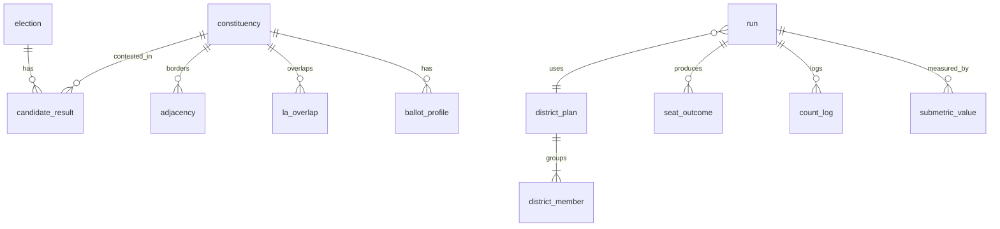

# Data Model

## Storage layout

| Store | Format | Holds | Written by | Published? |
|-------|--------|-------|-----------|------------|
| `spec/` | TOML, version-controlled | Frozen methodology: configurations, anchors, star bands, profiles, criteria table, reference contest, weight profiles, grade rules | Maintainer, by hand. Frozen by `vsm spec freeze` | Yes, in the repository |
| `data/sources.toml` | TOML | Source URLs, licences and SHA-256 checksums | Maintainer | Yes |
| `data/raw/` | Original downloads | Untouched source files | `ingest` | Open-licence files archived with each release. Licensed files are not |
| `data/private/` | Original downloads | Respondent-level British Election Study (BES) files | `ingest` | **Never.** Git-ignored |
| `reference.sqlite` | SQLite 3 | Canonical inputs: elections, constituencies, geography, parties, results, derived ballot profiles | Python stages | Yes, with each release (it contains no respondent-level data) |
| `runs.sqlite` | SQLite 3 | District plans, runs, seat outcomes, sub-metric values, aggregates, view results | Rust stages | Yes, with each release |
| `bundle/` | JSON | Site-ready extract | `vsm publish` | Yes, served by the site |

**Why SQLite and two files.** The pipeline is single-user, batch and local, so a server database (for example Postgres on NeonDB) would add operations work for no benefit. The split matches the language boundary: Python writes inputs and Rust writes outputs. Each file therefore has exactly one writer, and either can be rebuilt without touching the other. See ADR-0003.

## Entities

Types are SQLite affinities. `TEXT` IDs are human-readable codes such as Office for National Statistics (ONS) GSS codes, `C09` or `GE2024`. Every table carries `schema_version` through a single-row `meta` table, which is not repeated below.

### `reference.sqlite`

#### election

- **Purpose**: A reference election.
- **Primary key**: `election_id` (e.g. `GE2024`, `SEN2026`)
- **Lifecycle**: Created by `ingest`. Never deleted.
- **Owner**: ingest

| Field | Type | Nullable | Notes |
|-------|------|----------|-------|
| election_id | TEXT | no | |
| office | TEXT | no | `commons`, `devolved`, `council` or `executive` |
| polling_date | TEXT | no | ISO 8601 |
| boundary_set | TEXT | no | e.g. `WM2023`; notional results are a separate election ID such as `GE2019N` |
| source_id | TEXT | no | Foreign key (FK) to `source` |

#### constituency

- **Purpose**: A 2023 Westminster constituency, the building block of every district plan.
- **Primary key**: `gss_code`
- **Lifecycle**: Created by `ingest`, enriched by `geography`.
- **Owner**: ingest and geography

| Field | Type | Nullable | Notes |
|-------|------|----------|-------|
| gss_code | TEXT | no | |
| name | TEXT | no | |
| nation | TEXT | no | `E`, `S`, `W` or `N` |
| region | TEXT | yes | English region or nation |
| county | TEXT | yes | Ceremonial county, used to keep districts together |
| electorate | INTEGER | no | Registered electors at the reference date |
| area_km2 | REAL | yes | From OS Boundary-Line. NULL until `geography` runs; `geography` fails if any remain NULL |
| protected | INTEGER | no | 1 for the five protected seats |

#### adjacency

- **Purpose**: Undirected contiguity edges between constituencies (shared boundary longer than zero). Water crossings are listed explicitly.
- **Primary key**: `(gss_a, gss_b)` with `gss_a < gss_b`
- **Owner**: geography

| Field | Type | Nullable | Notes |
|-------|------|----------|-------|
| gss_a, gss_b | TEXT | no | FK to constituency |
| kind | TEXT | no | `land` or `declared_crossing` (for example island seats) |
| shared_m | REAL | yes | Shared boundary length in metres (`land` edges) |
| note | TEXT | yes | The route, for `declared_crossing` edges (from `data/crossings.toml`) |

#### la_overlap

- **Purpose**: Overlap between constituencies and principal local authorities, for coterminosity (sub-metric G3).
- **Primary key**: `(gss_code, la_code)`

| Field | Type | Nullable | Notes |
|-------|------|----------|-------|
| gss_code | TEXT | no | |
| la_code | TEXT | no | |
| share_of_constituency | REAL | no | Share of the constituency's area or electors (rule declared in the spec) |

#### party

- **Purpose**: Project party registry. It maps source names to stable codes and holds the "Other" grouping rule (each party under 0.5 % of the vote is grouped).
- **Primary key**: `party_code`

| Field | Type | Nullable | Notes |
|-------|------|----------|-------|
| party_code | TEXT | no | e.g. `LAB`, `CON`, `LD`, `REF`, `GRN`, `SNP`, `PC` |
| name | TEXT | no | |
| aliases | TEXT | yes | JSON array of source spellings |

#### area

- **Purpose**: Official names and codes per layer (ADR-0014), for sources that publish names only.
- **Primary key**: `(layer_id, gss_code)`
- **Owner**: ingest

| Field | Type | Nullable | Notes |
|-------|------|----------|-------|
| layer_id | TEXT | no | FK to `geography_layer` |
| gss_code | TEXT | no | |
| name | TEXT | no | Official English name |

#### list_result

- **Purpose**: Observed result per list per list-PR contest (e.g. Senedd 2026). An individual candidate is a list of one.
- **Primary key**: `(election_id, gss_code, list_seq)`
- **Owner**: ingest

| Field | Type | Nullable | Notes |
|-------|------|----------|-------|
| election_id, gss_code | TEXT | no | FK to `contest` |
| list_seq | INTEGER | no | Order by votes, descending |
| party_code | TEXT | no | `IND` for individual candidates |
| individual_name | TEXT | yes | Set for individual candidates |
| votes | INTEGER | no | |
| seats | INTEGER | no | Seats won |
| candidates | INTEGER | no | List size: the most seats the list can win |

#### seat_order

- **Purpose**: The declared order in which a list-PR contest's seats were allocated.
- **Primary key**: `(election_id, gss_code, position)`

| Field | Type | Nullable | Notes |
|-------|------|----------|-------|
| election_id, gss_code | TEXT | no | |
| position | INTEGER | no | 1 = first seat allocated |
| list_seq | INTEGER | no | FK to `list_result` |

#### contest

- **Purpose**: One constituency contest in one election: the totals each `candidate_result` set must add up to.
- **Primary key**: `(election_id, gss_code)`
- **Owner**: ingest

| Field | Type | Nullable | Notes |
|-------|------|----------|-------|
| election_id | TEXT | no | |
| gss_code | TEXT | no | |
| electorate | INTEGER | no | Electorate for this election (`constituency.electorate` is the reference election's) |
| valid_votes | INTEGER | no | Ingest stops unless candidate votes sum to this |
| invalid_votes | INTEGER | yes | |
| declared_at | TEXT | yes | Declaration time where the source gives one (candidate source for sub-metric I2) |

#### geography_layer

- **Purpose**: The geography register (ADR-0014). One row per area type and vintage the project uses. Mirrors `data/geographies.toml`.
- **Primary key**: `layer_id` (e.g. `PCON2024`, `LAD20240704`, `OA2021EW`)
- **Owner**: ingest

| Field | Type | Nullable | Notes |
|-------|------|----------|-------|
| layer_id | TEXT | no | |
| gss_prefixes | TEXT | no | JSON array of entity prefixes, e.g. `["E14","S14","W07","N05"]` |
| drawn_by | TEXT | no | e.g. `BCE, BCS, BCW, BCNI` |
| valid_from | TEXT | no | ISO 8601 |
| valid_to | TEXT | yes | NULL while current |
| source_id | TEXT | no | FK to `source` |

#### geography_link

- **Purpose**: A cross-layer relationship (ADR-0014). Official lookups first; spatial overlays only where none exists.
- **Primary key**: `(from_layer, from_code, to_layer, to_code)`
- **Owner**: ingest (official lookups) and geography (overlays)

| Field | Type | Nullable | Notes |
|-------|------|----------|-------|
| from_layer, to_layer | TEXT | no | FK to `geography_layer` |
| from_code, to_code | TEXT | no | GSS codes |
| relation | TEXT | no | `exact`, `best_fit_population`, `area_weighted` or `partial` (official membership, no share; ADR-0014 amendment) |
| share | REAL | yes | 1.0 for `exact`; NULL for `partial`; otherwise the share of `from_code` assigned to `to_code` |
| derived | INTEGER | no | 1 when computed by VSM rather than taken from an official lookup |

#### candidate_result

- **Purpose**: Observed result per candidate per contest.
- **Primary key**: `(election_id, gss_code, candidate_seq)`

| Field | Type | Nullable | Notes |
|-------|------|----------|-------|
| election_id | TEXT | no | |
| gss_code | TEXT | no | Or district code for non-Westminster contests |
| candidate_seq | INTEGER | no | |
| party_code | TEXT | no | `IND` for independents |
| votes | INTEGER | no | |
| elected | INTEGER | no | 0 or 1 |

#### ballot_profile

- **Purpose**: S1 sincere ballots per constituency, as weighted party rankings. Derived from BES through multilevel regression and post-stratification (MRP). **Aggregated: no respondent-level rows.**
- **Primary key**: `(model_version, gss_code, ranking)`
- **Lifecycle**: Replaced as a whole whenever `model_version` changes. Old versions are kept for reproducibility.
- **Owner**: preferences

| Field | Type | Nullable | Notes |
|-------|------|----------|-------|
| model_version | TEXT | no | Hash of the preference-model code, inputs and seed |
| gss_code | TEXT | no | |
| ranking | TEXT | no | Party codes in order, e.g. `LAB>GRN>LD` (truncated rankings allowed) |
| weight | REAL | no | Share of the constituency's valid votes |
| draw | INTEGER | no | Posterior draw index, to carry model uncertainty into the band |

#### source

- **Purpose**: Provenance for every input file.
- **Primary key**: `source_id`

| Field | Type | Nullable | Notes |
|-------|------|----------|-------|
| source_id | TEXT | no | |
| url | TEXT | no | |
| licence | TEXT | no | e.g. `OGL-3.0` |
| sha256 | TEXT | no | |
| retrieved | TEXT | no | ISO 8601 |
| redistributable | INTEGER | no | 0 for BES respondent-level files |

### `runs.sqlite`

#### district_plan and district_member

- **Purpose**: A seeded, valid plan grouping constituencies into multi-member districts.
- **Primary key**: `(config_id, plan_idx)`; members `(config_id, plan_idx, gss_code)`
- **Owner**: districts

| Field | Type | Nullable | Notes |
|-------|------|----------|-------|
| config_id | TEXT | no | |
| plan_idx | INTEGER | no | 0–19. Single-member configurations use the identity plan, index 0 only |
| seed | TEXT | no | Derived seed (hex) |
| district_code | TEXT | no | On `district_member` |
| tier | TEXT | no | `constituency` or `list`, for mixed systems |
| magnitude | INTEGER | no | On the district |

#### run

- **Purpose**: One count.
- **Primary key**: `run_id` (hash of the fields below)
- **Owner**: runs

| Field | Type | Nullable | Notes |
|-------|------|----------|-------|
| run_id | TEXT | no | |
| spec_hash | TEXT | no | |
| config_id | TEXT | no | |
| election_id | TEXT | no | |
| scenario | TEXT | no | `S0` or `S1` |
| plan_idx | INTEGER | no | |
| pref_draw | INTEGER | yes | S1 only |
| status | TEXT | no | `ok` or `failed`; failed runs are never aggregated silently |

#### seat_outcome

- **Purpose**: Seats per party per district per run, with the last-seat margin needed for E3.
- **Primary key**: `(run_id, district_code, party_code)`

| Field | Type | Nullable | Notes |
|-------|------|----------|-------|
| seats | INTEGER | no | |
| votes | REAL | no | Votes or first preferences counted for the party in the district |
| last_seat_margin_pts | REAL | yes | District-level; stored on the winner row |

#### count_log

- **Purpose**: Stage-by-stage counts for preferential rules (transfers, eliminations, exhaustion). Compressed JSON per district.
- **Primary key**: `(run_id, district_code)`

#### submetric_value

- **Purpose**: Raw and normalised value of one sub-metric for one run.
- **Primary key**: `(run_id, submetric_id)`

| Field | Type | Nullable | Notes |
|-------|------|----------|-------|
| submetric_id | TEXT | no | `P1` … `I3`, plus reported-only IDs such as `F2_ENPP` |
| raw | REAL | yes | Null when the sub-metric is not applicable (N/A), never zero |
| score | REAL | yes | 0–100 after the anchor function. Null for N/A and reported-only |

#### score_summary

- **Purpose**: Aggregated result per configuration, sub-metric or axis.
- **Primary key**: `(spec_hash, profile, config_id, metric_id)`

| Field | Type | Nullable | Notes |
|-------|------|----------|-------|
| metric_id | TEXT | no | Sub-metric ID, axis letter or cluster letter |
| median, p10, p90 | REAL | yes | |
| grade | TEXT | yes | `A`, `B`, `B-int` or `C` |
| stars | INTEGER | yes | 1–5 from the frozen bands, on the median |
| n_runs | INTEGER | no | |

#### view_result

- **Purpose**: Serialised output of each view (Pareto, Punter at axis and cluster level, Fair Fight, profile ranks, sensitivity).
- **Primary key**: `(spec_hash, profile, view_id)`; the payload is JSON

### `spec/` (TOML, not a database)

| File | Contents |
|------|----------|
| `configurations.toml` | C01–C20 with every parameter of methodology §2 (`null` where not applicable) |
| `profiles.toml` | Sub-metric applicability per office profile (scored, N/A or reported) |
| `anchors.toml` | Per sub-metric: function (`lin`, `log`, `pct`, `inv_pct`), the value scoring 100, the value scoring 0, and the rationale |
| `stars.toml` | Bands 80, 60, 40, 20 |
| `reference_contest.toml` | 6 parties, 3 candidates per party; sensitivity variants with 4 and 8 parties |
| `criteria.toml` | S1 compliance table: rule × criterion → `pass`, `fail`, `na` or `unresolved`, each with a citation |
| `weights.toml` | Seven weight profiles, each with a rationale line beside its largest weights |
| `grades.toml` | Evidence grade per (configuration, profile, sub-metric), with the evidence reference |
| `scenarios.toml` | S0 and S1 definitions, the tie rule, E3's 10-point margin and its 5 and 15 point sensitivity values |
| `FROZEN` | Version, ISO date and SHA-256 over the canonicalised files above |

## Relationships

Across the two files, references are by code (`gss_code`, `election_id`) and are checked by `vsm check refs`. SQLite cannot enforce foreign keys between database files. Within a file, foreign keys are declared and `PRAGMA foreign_keys = ON` is set on every connection. Deleting runs is never cascaded: a spec change produces a new `spec_hash` partition and leaves old runs untouched.

## Indexes

| Index | Serves |
|-------|--------|
| `candidate_result(election_id, gss_code)` | Building district vote totals for each run |
| `ballot_profile(model_version, gss_code, draw)` | S1 ballot expansion per district |
| `run(spec_hash, config_id)` | Aggregating all runs of a configuration |
| `submetric_value(submetric_id)` | Per-metric aggregation and the correlation audit |
| `seat_outcome(run_id)` | Hemicycle and hex-map export |

## Migrations

- Schema DDL lives in `schema/reference/NNNN_description.sql` and `schema/runs/NNNN_description.sql`. Files are applied in order and recorded in `meta`.
- Python applies reference migrations and Rust applies runs migrations. Each refuses to open a database whose `schema_version` is newer than it knows.
- No down-migrations. Both databases are rebuildable artefacts, so the rollback is to rebuild from the tagged release.

## Retention

- `reference.sqlite` and `runs.sqlite` from every tagged release are kept permanently in the release archive, because published scores must stay reproducible.
- Local working copies may be deleted at will.
- `data/private/` is kept only while the BES licence allows. Deleting it does not break reproducibility of published results, because downstream stages use only `ballot_profile`.

## Data invariants

Enforced in code by `vsm check` and run after every stage. Where possible they are also enforced as SQL `CHECK` constraints.

1. For every `ok` run, the total seats equal the configuration's house size (650 for the Commons).
2. For every district, the seats awarded equal the district magnitude.
3. Each constituency appears in exactly one district per tier per plan, and every district in a plan is contiguous through `adjacency`.
4. Districts never cross nation boundaries.
5. `ballot_profile` weights sum to 1 ± 1e-9 per (model version, constituency, draw).
6. `score` is null exactly when the profile marks the sub-metric N/A or reported-only. A score of 0 is never used to mean "not applicable".
7. Every `run.spec_hash` equals the hash in `spec/FROZEN` at the time of the run.
8. Every score lies in [0, 100] after clamping, and p10 ≤ median ≤ p90.
9. Under S0, each constituency's total votes equal its observed valid votes.
